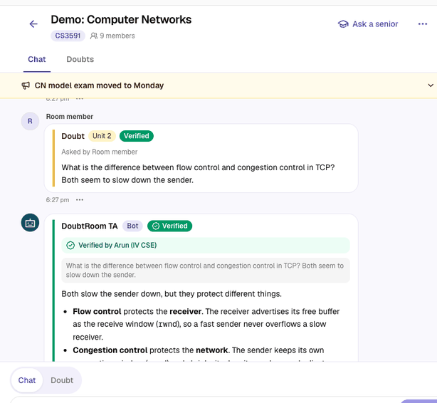
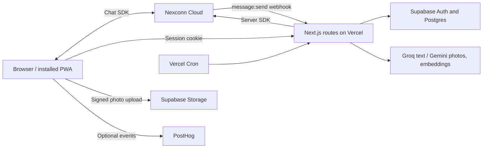

# DoubtRoom

Exam-season study rooms for Anna University students. Ask a question in your subject room, read the AI teaching assistant’s answer and see which answers a senior has checked.

[Live app](https://doubtroom-ochre.vercel.app) · [Try the demo](https://doubtroom-ochre.vercel.app/try) · [Demo video](https://doubtroom-ochre.vercel.app/downloads/doubtroom-demo.mp4) · [Live impact](https://doubtroom-ochre.vercel.app/impact) · [Project write-up](https://doubtroom-ochre.vercel.app/downloads/doubtroom.pdf)

Built during the Nexconn Build Challenge 2026 (Nov 18 to 22, 2026).



## The problem

A question about TCP can disappear under timetable updates in the class group. The senior who knows the answer may be in another section. On exam morning, the student still has to work out which explanation to revise.

## What students can do

- Sign in with Google and choose a department, year and section to join subject and class rooms.
- Post a question with a unit or photo, or mention @TA in chat. DoubtRoom TA replies in the room. Photo doubts are read by Gemini, and answers can cite uploaded course notes as [S1], [S2].
- Upvote a helpful answer. A course mentor can verify it, add a correction and find outstanding questions in the mentor inbox.
- Open a private chat with a senior from an answer. The question travels with the conversation.
- Read a pinned announcement. Group read receipts for announcements show "Seen by X of Y" and a reader list to class reps. If the plan does not expose receipts, the card falls back to "Delivered to N members".
- Enter a scheduled Exam Eve open channel to revise together and ask the TA.
- Review the morning recap of eligible answers from the previous day.
- Start a 24-hour judge session without Google sign-in. The Computer Networks sandbox includes seeded classmates and a scripted demo mentor.

## Nexconn integration

| Feature | Nexconn capability | Implementation |
| --- | --- | --- |
| Chat identity | Server `issueAccessToken`, client `NCEngine.connect` | [Session](src/app/api/session/route.ts), [client](src/lib/nexconn/client.ts) |
| Subject and section groups | `createGroupChannel`, `joinGroupChannel` | [Provisioning](src/lib/rooms/provision.ts), [server adapter](src/lib/nexconn/server.ts) |
| Room history and messages | `sendMessage`, `createMessagesQuery`, group mentions and image messages | [Group chat](src/components/chat/GroupChat.tsx), [history](src/components/chat/useChannelHistory.ts) |
| Doubt, answer, announcement and recap cards | `registerCustomMessages` | [Payloads](src/lib/nexconn/messages.ts), [registration](src/lib/nexconn/client.ts) |
| TA in the room | `sendGroupChannelMessage` from `bot_ta` | [TA route](src/app/api/ta/ask/route.ts) |
| TA trigger | `message:send` webhook (signature checked, deduplicated by message ID), with a client relay fallback | [Webhook](src/app/api/nexconn/webhook/route.ts) |
| Live upvotes and verification | Server message metadata, client metadata updates | [Answer actions](src/lib/answers/server.ts), [group chat](src/components/chat/GroupChat.tsx) |
| Mentor DMs | Direct channels, typing status and read receipts | [Direct chat](src/components/chat/DirectChat.tsx), [read receipts](src/components/chat/useReadReceipts.ts) |
| Mentor availability | Online-status subscription, with `getUserConnectionStatus` polling as a fallback | [Presence adapter](src/lib/nexconn/presence.ts), [cached lookup](src/lib/mentors/presence-cache.ts) |
| Announcement readers | Receipt requests, `sendReadReceiptResponse`, receipt users query | [Group receipts](src/components/chat/useGroupReceipts.ts), [reader list](src/components/chat/ReadersSheet.tsx) |
| Exam Eve | Open channel creation, entry and bot messages | [Provisioning](src/lib/eves/server.ts), [client](src/components/eve/useOpenChannel.ts) |
| Room moderation | Group mute list and profanity list | [Moderation adapter](src/lib/nexconn/moderation.ts), [seed](scripts/seed-moderation.ts) |
| Reconnect | Connection status handler, history backfill | [Client](src/lib/nexconn/client.ts), [connection banner](src/components/chat/ConnectionBanner.tsx) |

## Architecture



Nexconn delivers messages directly to each connected browser. Its `message:send` webhook tells the server when a doubt card or @TA mention needs an answer; the browser also asks `/api/ta/ask` as a backup, and the server reserves each message once. Groq `openai/gpt-oss-120b` answers text doubts, @TA, Exam Eve and the recap. Gemini `gemini-3.5-flash-lite` reads photo doubts and is the text fallback. `gemini-embedding-2` grounds answers in uploaded notes. Supabase stores identities, enrolments, answer reviews and study-room records. Vercel checks permissions, requests AI answers and posts them as the TA. Its morning cron publishes recaps at 07:00 IST. [Sequence diagrams](docs/ARCHITECTURE.md)

## Traction

Live figures, with the time they were last updated, are on the [public impact dashboard](https://doubtroom-ochre.vercel.app/impact).

## Run locally

Install Node.js 24 and pnpm 12.14.0, then run these commands from the repository root. Before seeding, configure the services below and fill in the provider credentials in `.env.local`.

```sh
cp .env.example .env.local
pnpm install --frozen-lockfile
pnpm seed
pnpm test
pnpm dev
```

Visit [localhost:3000](http://localhost:3000). For a release, run `pnpm typecheck`, `pnpm lint` and `pnpm build`. See the [environment variable list](.env.example).

## Deploy

1. Create a Supabase project. Apply the SQL files in [supabase/migrations](supabase/migrations) in filename order. Create the public `doubt-images` bucket with a 5 MB limit and allow JPEG, PNG, WebP and HEIC. The server grants signed uploads after checking room membership.
2. Enable Google in Supabase Auth. Configure the Google OAuth client with the callback URI Supabase displays. Set the Supabase site URL to the production origin and allow the app’s `/auth/callback` URL.
3. Create a Nexconn Chat app. Copy its App Key, App Secret and API domains into the matching server variables. Use the same public App Key in the browser configuration. Enable the receipt and presence capabilities available on your plan.
4. Link the checkout with `vercel link`. Set the application variables in Vercel Production and any Preview environment you use. Configure the two AI providers, role invite codes, demo signing secret, cron secret and optional PostHog project. Set the public app URL to the deployed origin. A change to a public variable requires a new build.
5. Run `pnpm seed` with the intended environment, then `vercel deploy --prod`. Open `/try` in a new browser profile to test the sandbox. Use two distinct identities to test chat delivery.

## Security

The server resolves the chat actor from Google authentication or a signed, expiring demo cookie. Membership and course roles govern room APIs and verification. Service-role credentials, the Nexconn App Secret and model keys stay server-side. AI requests have per-user, room and global limits. Demo profiles have scoped access to the sandbox and its demo mentor. [Privacy](https://doubtroom-ochre.vercel.app/privacy) · [Terms](https://doubtroom-ochre.vercel.app/terms)

## Project structure

| Path | Contents |
| --- | --- |
| [src/app](src/app) | App Router pages, authentication and API routes |
| [src/components](src/components) | Room, direct chat, admin, mentor and judge interfaces |
| [src/lib](src/lib) | Nexconn, model providers, authorization and study-room logic |
| [data](data) and [scripts](scripts) | Course catalog, provenance, demo conversation and provisioning |
| [supabase](supabase) | Database migrations |
| [tests](tests) and [docs](docs) | Regression checks, implementation status, decisions and quality evidence |

## Prior work and tools

DoubtRoom’s application code was built during the challenge. The project uses the open-source libraries in [package.json](package.json). The [catalog sources](data/catalog-sources.md) and [QA worksheet](docs/PHASE-5-QA.md) identify externally sourced material.

Built with Claude Code, OpenAI Codex and the Nexconn `nexconn-chat` skill.

[MIT License](LICENSE) · [Contact Dhaanish on GitHub](https://github.com/dhaanish597)
