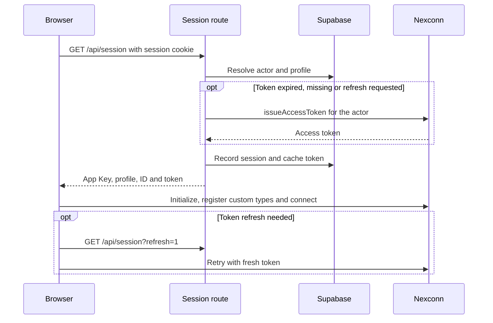
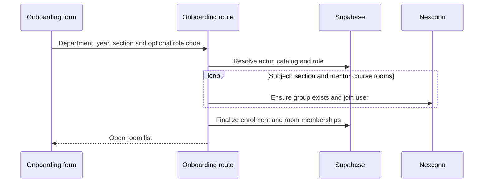
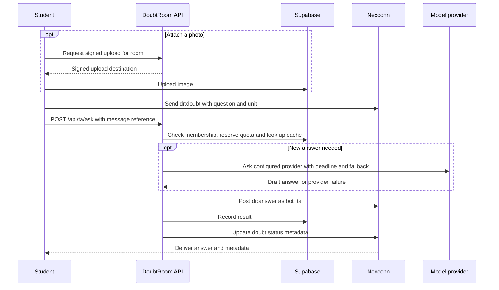
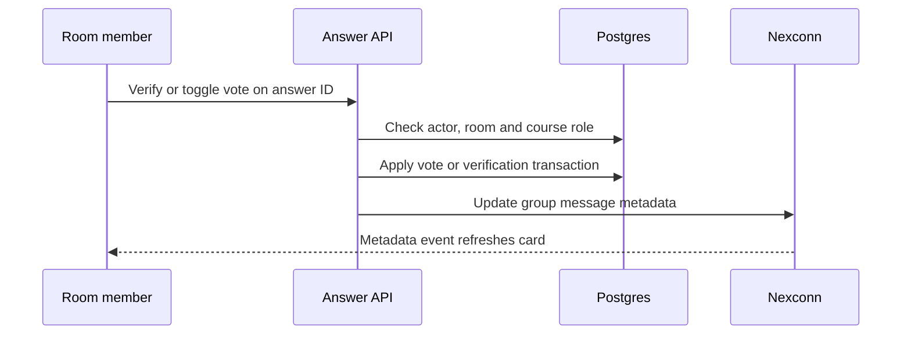
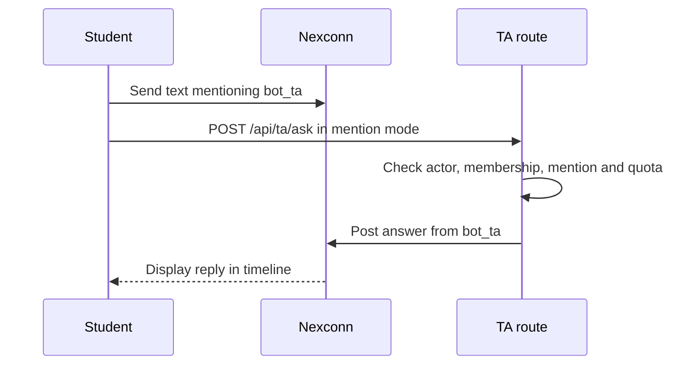
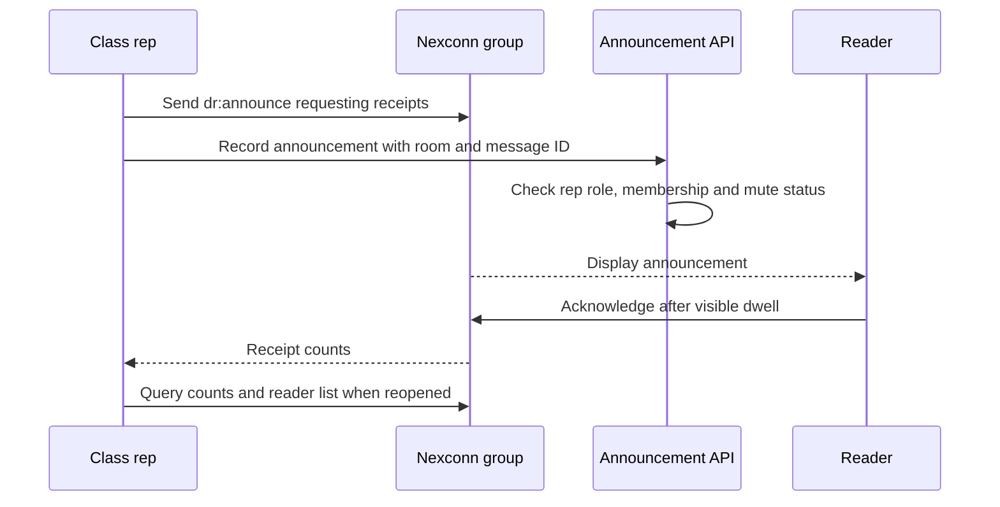
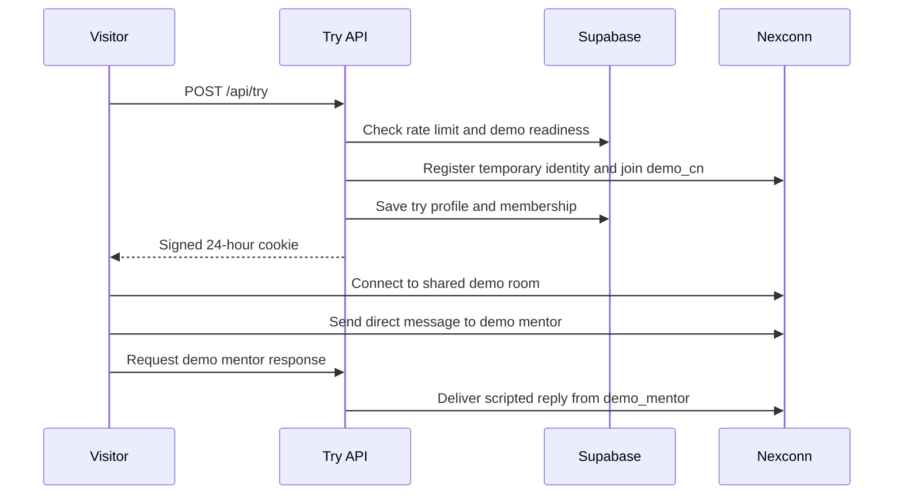

# DoubtRoom architecture

The browser owns the Nexconn connection. The Next.js server controls room enrolment, model calls, moderation and persistence. Each diagram follows an action from its UI to its durable record or chat message.

## Connect a browser

## Onboard a student

## Ask a doubt

A provider or quota failure produces a visible status card. The seven-day cache can reuse eligible text answers. Photos take the image-aware provider path.

## Verify or upvote

The mentor inbox and room board use the stored answers. The chat card uses message metadata so a reader can see the result without opening the board.

## Mention the TA in normal chat

## Read an announcement

## Enter the judge sandbox

## Exam Eve and the morning recap

Vercel schedules `/api/cron/recap` at 01:30 UTC (07:00 IST). The job provisions upcoming Exam Eve open channels and selects recap candidates from the preceding 24 hours. Within each room, it ranks verified answers first, then by upvotes, and selects at most five distinct doubts. A room/day claim coordinates overlapping invocations. [Selection rules](../src/lib/recap/rules.ts) · [Job](../src/lib/recap/server.ts) · [Schedule](../vercel.json)
