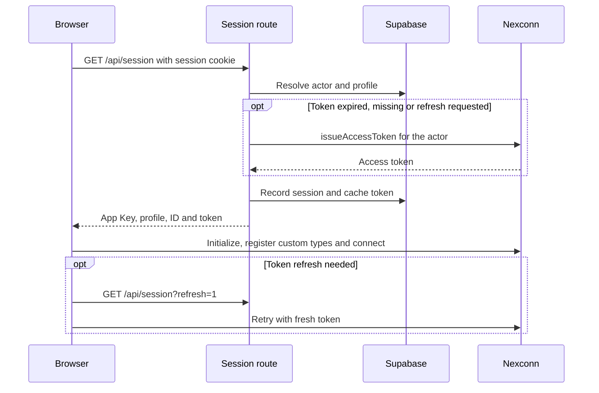
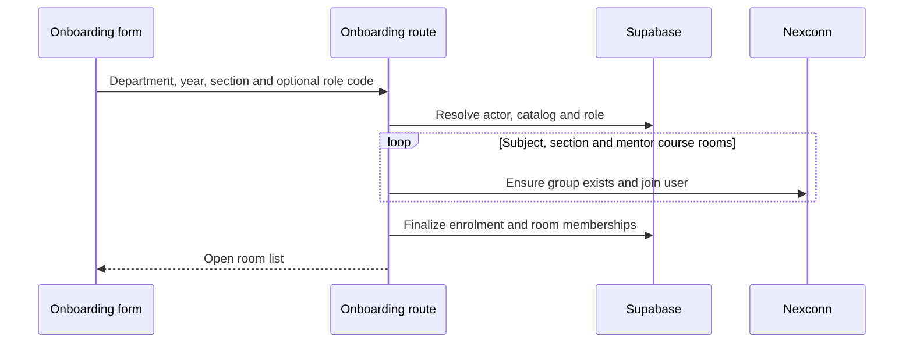
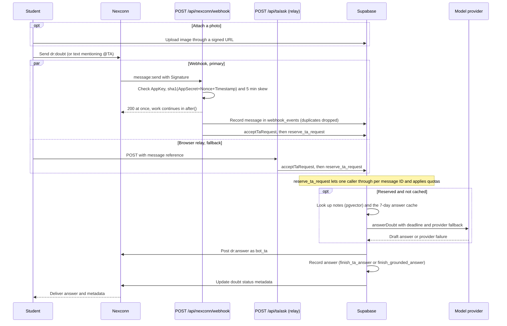
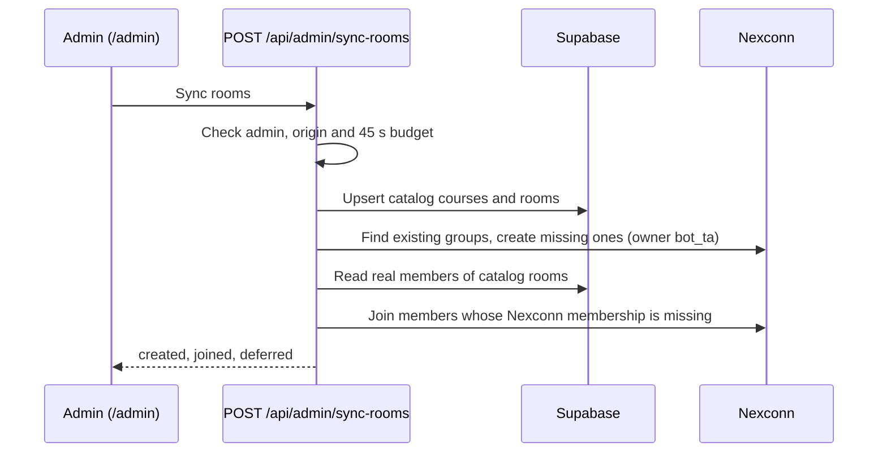
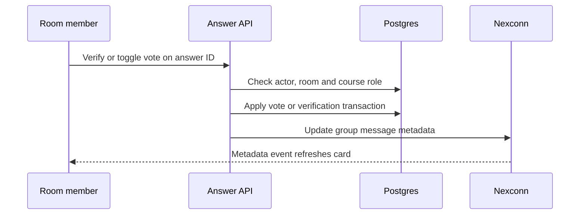
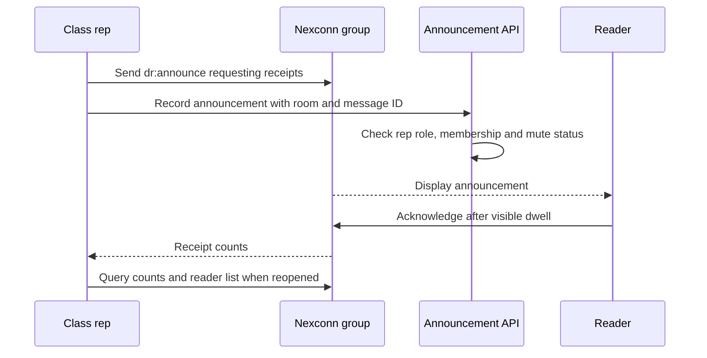
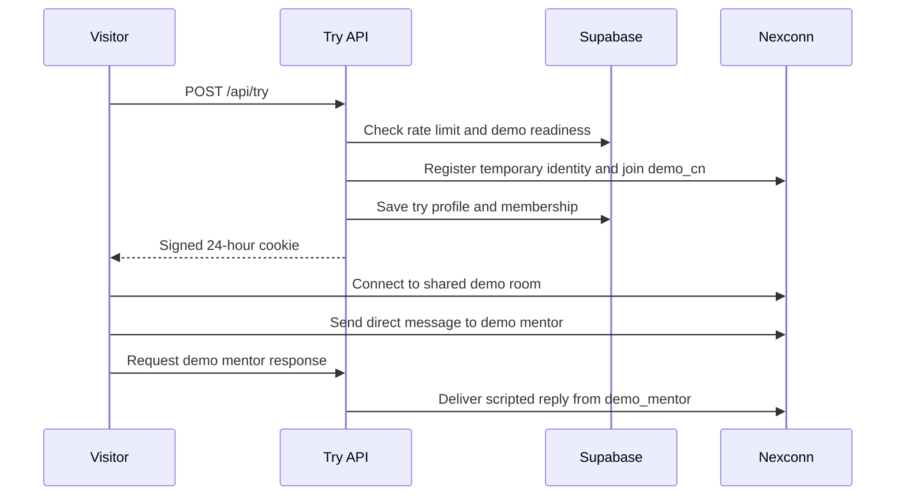

# DoubtRoom architecture

The browser owns the Nexconn connection. The Next.js server controls room enrolment, model calls, moderation and persistence. Each diagram follows an action from its UI to its durable record or chat message.

## Connect a browser

## Onboard a student

## Ask a doubt

Two triggers lead to the same work. Nexconn's `message:send` webhook is the primary path. The browser relay (`/api/ta/ask`) is a fallback. Both call `acceptTaRequest` ([src/lib/ta/accept.ts](../src/lib/ta/accept.ts)), which checks room membership and the unit and photo URL, then calls the `reserve_ta_request` database function. That function reserves the message ID, so a doubt is answered once even when both triggers fire.

Model providers: text doubts, @TA mentions, Exam Eve answers and recaps go to Groq `openai/gpt-oss-120b` (`LLM_PRIMARY=groq`). A photo doubt always tries Gemini `gemini-3.5-flash-lite` first, and Gemini is the fallback for text. Notes are embedded with `gemini-embedding-2` for grounded answers with [S#] sources. See D-016 and D-017 in [DECISIONS.md](DECISIONS.md) and [src/lib/ai/answer.ts](../src/lib/ai/answer.ts).

A provider or quota failure produces a visible status card. The seven-day cache can reuse eligible text answers. Photos take the image-aware provider path. Nexconn's signature does not cover the body, so membership, quota and message-ID checks bound any replayed delivery (D-018).

## Sync rooms

The job lives in [src/lib/rooms/sync.ts](../src/lib/rooms/sync.ts). It is idempotent, joins up to 100 members per batch call, and returns `deferred` when the time budget ends, so the admin runs it again until `deferred` is 0. Demo rooms and try visitors are skipped.

## Verify or upvote

The mentor inbox and room board use the stored answers. The chat card uses message metadata so a reader can see the result without opening the board.

## Mention the TA in normal chat

A text message that mentions `bot_ta` follows the same two triggers as a doubt (webhook first, browser relay as fallback) in `mention` mode. `acceptTaRequest` checks the actor, membership, the mention and the quota. The answer is posted by `bot_ta` and shows in the timeline.

## Read an announcement

## Enter the judge sandbox

## Exam Eve and the morning recap

Vercel schedules `/api/cron/recap` at 01:30 UTC (07:00 IST). The job provisions upcoming Exam Eve open channels and selects recap candidates from the preceding 24 hours. Within each room, it ranks verified answers first, then by upvotes, and selects at most five distinct doubts. A room/day claim coordinates overlapping invocations. [Selection rules](../src/lib/recap/rules.ts) · [Job](../src/lib/recap/server.ts) · [Schedule](../vercel.json)
